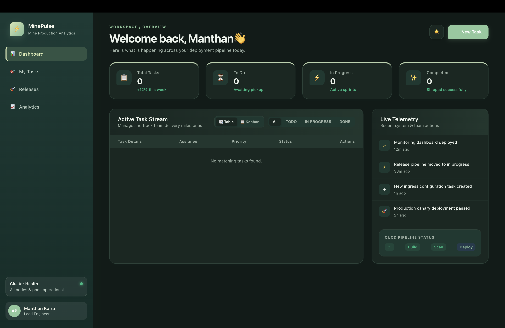
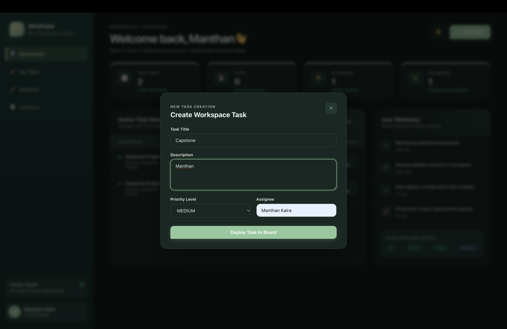
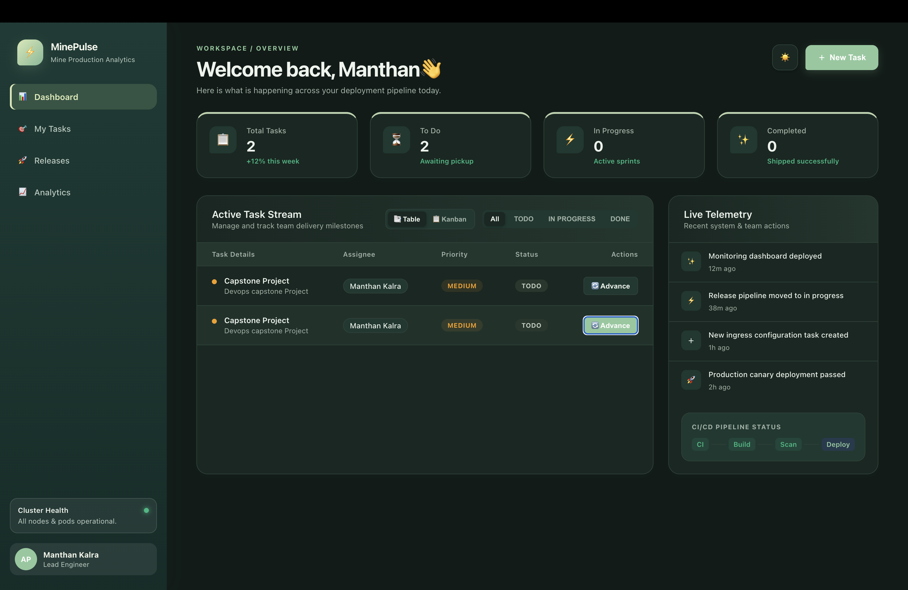
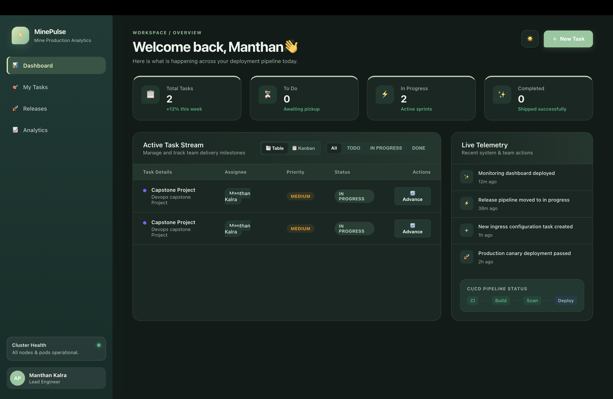
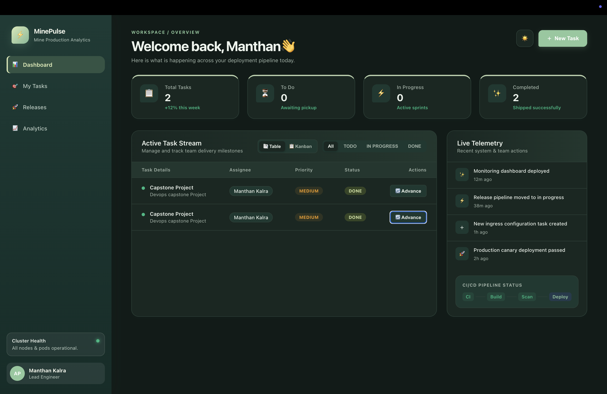
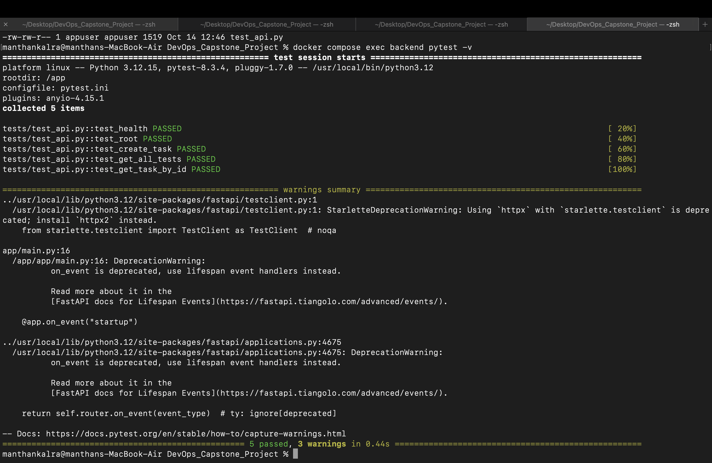

# MinePulse — DevOps Capstone Project

## Student Details

- **Name:** Manthan Kalra
- **Roll Number:** 24bcs10478
- **Batch:** Batch A

## Overview

MinePulse is a full-stack application demonstrating DevOps practices, including containerization, automated testing, CI/CD, Kubernetes deployment, monitoring, and infrastructure automation.

The current application retains task and release management functionality. Mine-production analytics is a potential future extension.

## Technology Stack

- **Frontend:** React, Vite, Nginx
- **Backend:** Python, FastAPI
- **Database:** PostgreSQL
- **Database Migrations:** Alembic
- **Testing:** pytest
- **Containerization:** Docker, Docker Compose
- **CI/CD:** GitHub Actions
- **Container Registry:** GitHub Container Registry (GHCR)
- **Security Scanning:** Trivy
- **Orchestration:** Kubernetes, Kind
- **Package Management:** Helm
- **GitOps:** ArgoCD
- **Monitoring:** Prometheus, Grafana
- **Infrastructure as Code:** Terraform, AWS

## Project Structure

```text
DevOps_Capstone_Project/
├── .github/
│   └── workflows/
│       └── cicd.yml
├── argocd/
├── backend/
│   ├── alembic/
│   ├── app/
│   ├── tests/
│   ├── Dockerfile
│   └── requirements.txt
├── demo/
├── frontend/
│   ├── src/
│   ├── Dockerfile
│   └── package.json
├── helm/
│   └── minepulse/
├── k8s/
├── monitoring/
├── screenshots/
├── scripts/
├── terraform/
├── docker-compose.yaml
├── .gitignore
└── README.md
```

## Run the Application

Start Docker Desktop and run these commands from the project root:

```bash
docker compose up --build -d
docker compose ps
```

### Application URLs

- **Frontend:** http://localhost:1919
- **Backend API Documentation:** http://localhost:3010/docs

To stop the application:

```bash
docker compose down
```

## Backend Testing

Run the backend test suite:

```bash
docker compose exec backend pytest -v
```

The backend test suite previously passed all five tests, covering health checks, the root endpoint, task creation, retrieving tasks, and retrieving a task by ID.

## Frontend Build

```bash
cd frontend
npm install
npm run build
cd ..
```

## Docker Compose

Docker Compose coordinates three services:

1. **Frontend** — React application served through Nginx.
2. **Backend** — FastAPI application.
3. **PostgreSQL** — Database service.

Useful commands:

```bash
docker compose ps
docker compose logs backend
docker compose logs frontend
docker compose logs postgres
docker compose down
```

## Database Migrations

The backend uses Alembic for database schema migrations.

```bash
docker compose exec backend alembic upgrade head
docker compose exec backend alembic current
```

## CI/CD Pipeline

The GitHub Actions workflow is located at:

`.github/workflows/cicd.yml`

The intended pipeline includes:

1. Checking out the source code.
2. Installing backend dependencies.
3. Running automated tests with pytest.
4. Building the frontend.
5. Building backend and frontend Docker images.
6. Scanning images using Trivy.
7. Publishing images to GHCR after successful scans.
8. Deploying to a temporary Kind cluster using Helm.

The complete pipeline must be verified in the project's own GitHub repository.

## Application Screenshots

### 1. Dashboard



### 2. Dashboard — View 2



### 3. Dashboard — View 3



### 4. Dashboard — View 4



### 5. Dashboard — View 5



### 6. API Documentation


### 7. Docker Status


### 8. Pytest Results



## Kubernetes and Helm

Kubernetes manifests are maintained in `k8s/`, and the Helm chart is maintained in `helm/minepulse/`.

Inspect the Kubernetes cluster:

```bash
kubectl config current-context
kubectl get nodes
kubectl get pods -A
kubectl get services -A
helm list -A
```

The deployment, namespaces, services, and container image references must be validated before claiming that deployment is successful.

## Monitoring

The `monitoring/` directory contains Prometheus-related configuration.

Prometheus targets and Grafana dashboards must be tested against the running application before claiming that monitoring is operational.

## Terraform and AWS

Terraform configuration is maintained in the `terraform/` directory.

Validate the configuration before provisioning infrastructure:

```bash
cd terraform
terraform init
terraform fmt -check
terraform validate
terraform plan
cd ..
```

Review the plan, AWS costs, and resource configuration before applying changes.

## Troubleshooting

### Frontend Build Error

```bash
cd frontend
npm install
npm run build
```

### Backend Test Failure

```bash
docker compose logs backend
docker compose exec backend pytest -v
```

### Docker Services Not Running

```bash
docker compose ps
docker compose logs
```

### Kubernetes Issues

```bash
kubectl config current-context
kubectl get nodes
kubectl get pods -A
```

## Project Status

- [x] Docker Compose configuration validated
- [x] Backend tests passed: 5 tests
- [ ] Frontend production build verified
- [ ] GitHub Actions pipeline verified
- [ ] GHCR image publishing verified
- [ ] Trivy security scans verified
- [ ] Kubernetes and Helm deployment verified
- [ ] Prometheus and Grafana monitoring verified
- [ ] AWS infrastructure provisioning verified

## Author

**Mathan Kalra**

Replace `YOUR_ROLL_NUMBER` and `YOUR_BATCH` with your correct details before submission.
